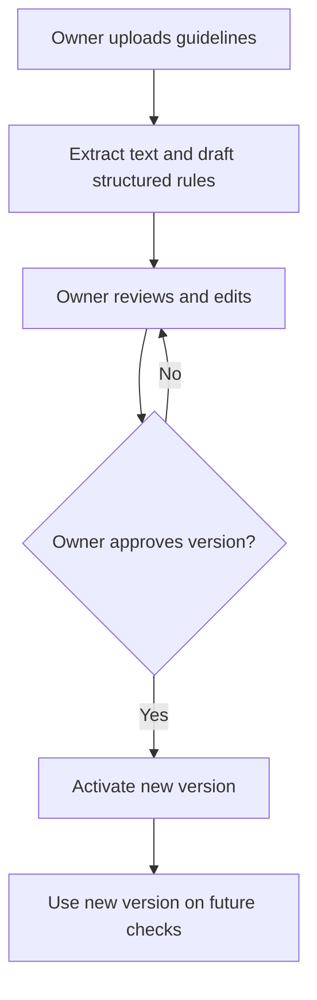
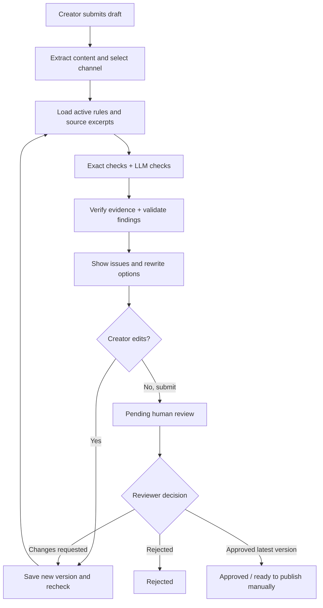

# Inkloom AI — Codex Implementation Plan

**Document type:** Root-level build specification and source of truth  
**Status:** Proposed working prototype, not an account of features already built  
**Last updated:** 2026-10-24  
**Primary goals:** (1) clear, low-friction UI/UX; (2) trustworthy, testable AI evaluations  
**Read with:** `AGENTS.md` (included separately)  
**Source:** `Inkloom_AI_MVP_Plan_Mermaid_Graph_Updated.docx` and our subsequent UI/UX and evaluation decisions

**2026-10-24 planning supplement:** See `docs/superpowers/specs/2026-10-24-ai-review-workflow-design.md`, `docs/superpowers/plans/2026-10-24-ai-review-workflow.md` and `docs/AI_WORKFLOW_TEST_PLAN.md` for the missing AI workflow, Word-style DOCX editing, free-only OpenRouter constraints, confidentiality controls, delivery order and test catalogue. User-confirmed changes are recorded in `docs/DECISIONS.md`; these documents are plans, not implementation or test completion claims.

> **Hackathon integrity gate:** Planning, researching and documenting may be done before the official build window, but implementation work that will be judged must happen **inside the event's permitted build window**. Confirm that window before generating or changing application code. Record creation dates and contributions. Do not represent mock output as working AI, or claim measured accuracy until tests have actually run.

---

## 0. Codex: first actions and working rules

1. Inspect the current repository, package manifests, routes, app structure, tests and README. **Do not overwrite existing work.**
2. Confirm the official hackathon build window has started before writing application code.
3. Read this document entirely. Make an inventory of implemented vs missing features. Verify up-to-date API interfaces from official documentation for AG-UI, CopilotKit and LangGraph; **do not invent package APIs**.
4. Create `docs/IMPLEMENTATION_STATUS.md` with a checklist of phases, verified commands, limitations and open decisions. Create `docs/DECISIONS.md` for choices different from this plan.
5. Start with one functioning vertical slice: owner creates organisation → activates rules → creator submits a text draft → receives evidence-backed findings → edits → reviewer approves → audit trail persists.
6. Implement in small testable phases. After each phase: run tests, lint/type checks, start the app, check one happy path and one negative path, and document results.
7. Use local development and test fixtures initially. An LLM provider is **not selected**; hide it behind an interface with explicit real and mock adapters. Mock mode must be conspicuously labelled and never disguised as real model output.
8. Do not add autonomous publication, campaign generation, a complex multi-agent hierarchy, background crawling, or direct social-network integrations to the first MVP.
9. When an architectural decision affects privacy, cost, permission semantics or the scope promised to judges, document the trade-off instead of silently choosing a risky default.

### Definition of done (end-to-end)

A first-time user can understand the app, create an organisation, upload/approve brand rules, submit an actual draft, see why issues were flagged with real supporting references, choose an editable correction or keep the original, recheck, send it to another authorised human, receive an approval decision, and inspect revision/audit history. A user from another organisation cannot access any of these records.

---

## 1. Product boundary and feature priorities

**Product:** A pre-publication brand-governance reviewer for organisations. Its main job is to **review and correct existing content**, not create marketing campaigns from scratch.

**Problems to solve:** Wrong prices or outdated facts; unsupported marketing promises; off-brand tone and terminology; simple visual/accessible-text mistakes; inconsistent posts made by different employees; lost approvals and earlier versions; unclear company rules.

### P0 — core demo (build first)

- Login/account; organisation creation; membership roles `owner`, `creator`, `reviewer` (owner also has reviewer powers).
- An owner uploads PDF/DOCX brand documents and/or enters editable approved facts, terminology and tone rules. All extracted structured rules require **owner confirmation** before activation.
- Versioned brand guidelines: at most one **active** version per organisation at a time, with older versions preserved for historical reviews; support source version IDs.
- Draft editor for pasted text, social captions, website copy; channel selector (`General`, `LinkedIn`, `Instagram`, `Website`, `Email`, `Advertisement`). A channel is *review context*, not a separate engine.
- Text-based PDF uploads and basic OCR of image/screenshot text where feasible. If OCR is unavailable or extraction fails, say so; don't claim the image was checked.
- Rule engine + RAG retrieval + contextual LLM evaluation with verifiable citations, clear issue statuses and two candidate rewrites **when safe and possible**.
- Creator edits in place, saves revisions, rechecks and requests review. Reviewers can comment, request changes, approve. **No self-approval by a creator; no automatic approval or publication.**
- Review progress and chat/follow-up messages use **AG-UI events**. Durable records and permissions use regular authenticated server APIs.
- Simple content list (including social posts) and reviewer approval queue; basic dashboard with status counts.
- Critical error handling, audit logs, basic data isolation/security tests, offline AI evaluation suite.

### P1 — three named judging improvements (implement after P0 is stable)

1. **Visual brand checks:** vision model compares uploaded image/screenshot to approved logo exemplars and layout guidance; deterministic color/contrast checks, with uncertain results marked advisory.
2. **Guideline-aware follow-up assistant:** explain a finding, ask questions about approved rules, suggest edits; use the same secured sources and verify all cited references.
3. **Governance insights:** counts by category/severity/channel, repeat violations, unresolved/unclear rules and approval turnaround. No unsupported predictions.

### P2 — after-event roadmap

Chrome extension, Slack bot, safe live-website scanning, social-media/CMS publishing integrations, calendar scheduling, video/audio, advanced OCR, full visual/layout validation, complex approval chains and cross-platform publishing. Clearly label all as **not in MVP**.

### Deliberately excluded from P0

- Automatic publishing or scheduling; fetching arbitrary URLs; a general marketing content generator; user-uploaded executable plugins; complex template builders; full accessibility certification; guaranteed detection of every wrong logo; fake or inferred evidence.

---

## 2. User roles and permission rules

| Role | May do | Must not do |
|---|---|---|
| Owner | Create organisation, invite/manage users, approve and activate rule versions, see all organisation content, act as reviewer | Bypass audit history; see another organisation's private data |
| Creator | Create/edit own drafts, run reviews, accept or reject suggestions, submit, view comments and versions | Activate guidelines, change roles, approve own drafts |
| Reviewer | View assigned organisation drafts, comment, approve/reject/request changes, view review evidence | Change brand guidelines or membership unless also owner; approve their own submitted draft |

- An account may belong to multiple organisations. Selecting an organisation is explicit. The **server** validates memberships and `org_id` on every request.
- The owner is automatically assigned when creating an organisation. Invitations have expiring tokens and cannot grant an organisation role to an unverified identity.
- For the prototype, no team hierarchy beyond these roles; a reviewer can belong to the same organisation as a creator.
- The creator's own content **cannot be approved by that same user**, including if they have multiple roles. Use a second authorised human. If there is only one account, UI explains why it cannot be approved.
- Reviewer comments, approvals, role changes, rule activation and edits are append-only audit events with actor, timestamp and target version.

---

## 3. UI/UX specification — use an editor-first layout, not chat-only

### Principles

1. A first-time user must always know **where they are**, **what will happen next**, and **why content was flagged**.
2. Main navigation has no more than six top-level destinations. Avoid twenty format-specific pages.
3. A violation report is more important than an AI chatbot. Chat is a side panel for clarification, not the primary workflow.
4. Use concise plain language: `Needs changes`, `Evidence missing`, `Waiting for approval` instead of opaque "AI compliance 83%" messages.
5. Never silently rewrite content, upload to a provider, switch organisation, submit a draft or approve a post. Require explicit user action.
6. Distinguish `Confirmed mismatch`, `Unverified`, `Advisory` and `Passed checks` visually and in text; don't rely on color alone. Keep keyboard support, readable contrast, focus states and mobile layouts.
7. Show loading/progress, no-result, unsupported-file, error, permission-denied, no-guideline and disconnected-stream states explicitly.
8. If the user accepts a rewrite, mark existing review findings as **stale** until the new version is rechecked.

### Navigation and routes

- `/login` — sign in/sign up.
- `/onboarding` — create or join organisation.
- `/org/:orgId/dashboard` — queue overview, recent drafts, approval counts.
- `/org/:orgId/brand` — knowledge and assets, structured rules, guideline versions and activation.
- `/org/:orgId/reviews/new` and `/org/:orgId/reviews/:draftId` — **primary workspace**.
- `/org/:orgId/content` — all content, filters by channel/status, includes social post drafts.
- `/org/:orgId/approvals` — review queue and reviewer actions.
- `/org/:orgId/insights` — P1 analytics (simple status summary can appear on P0 dashboard).
- `/org/:orgId/settings` — members, invites, privacy settings and organisation configuration.

**Global UI shell:** left sidebar (desktop) or collapsed navigation (mobile), top bar with current organisation, current role, account and `New Review` action. Empty pages have a single useful call to action.

### Screen A — First-run onboarding

**Owner path:** register → create organisation (name only) → invite optional teammates → see `Add your brand rules` prompt. No irrelevant configuration forms.  
**Joiner path:** accept invitation → choose organisation → land on dashboard or assigned review.  
**Empty state:** `No approved guidelines yet. Add and activate rules before starting a compliance review.`  
**Acceptance:** invited user cannot see organisation data until verified and joined.

### Screen B — Brand Guidelines / Brand Kit

Layout: tabs `Guidelines`, `Approved Facts`, `Terms & Tone`, `Assets`, `Version History`. Avoid ten setup steps.

1. Owner uploads text-based PDF/DOCX; display name, size, upload progress and source status.
2. Backend extracts text, sections, page/paragraph references; runs ingestion and suggests structured rules for **owner review**. Malformed/scanned-only files show extraction warning, not success.
3. Show an editable review table: `Rule`, `Type`, `Source`, `Status`, `Approve/Edit/Discard`.
4. Rules include `official product name`, `approved price + currency + effective date`, `approved factual claim`, `prohibited term`, `required disclaimer`, `tone instruction`, `platform-specific instruction`; assign scope (`global` or channel).
5. Owner selects `Activate version`. Show which version becomes active, when and by whom. Previous versions stay read-only and citeable for old reviews.
6. Assets: upload one or more approved logo/image references, colors and basic usage descriptions. P0 stores files and metadata; P1 analyzes visual usage.
7. On version activation, new reviews use the new version; existing reports remain tied to the old one. Offer `Run again using new guidelines` for an earlier draft (creates a new review, not a silent mutation).

**Failure/guard:** unapproved extracted facts are never treated as authoritative. Warn on contradictory active facts; don't allow ambiguous facts to be silently marked `Confirmed`.

### Screen C — New Review / Main content workspace (highest priority)

Desktop layout concept (one page, no modal maze):

```text
+--------------------------------------------------------------------+
| Inkloom AI     [Organisation v]               [New Review] [Account]|
+----------------+---------------------------+-----------------------+
| Sidebar        | Draft / Preview           | Findings & Actions    |
| Dashboard      | Title                     | Status / progress     |
| New Review     | Channel [LinkedIn v]      | [Critical] Pricing    |
| Content        | Format [Text/PDF/Image]    | Exact phrase + reason |
| Approvals      | [Paste / Upload]          | Source: Brand v2 ...  |
| Brand          | [Editable draft]          | Option A / Option B   |
| Insights       |                           | [Apply] [Dismiss]     |
|                | [Save] [Check Content]     | [Ask why?]            |
|                | [Submit for approval]     |                       |
+----------------+---------------------------+-----------------------+
```

On a phone: stack `Draft`, `Findings`, `History` into clear tabs; keep `Check Content` accessible; don't create horizontal scrolling.

**Fields:** name/title (optional for a draft); channel (required); text input or file (required); optional product/campaign identifier; draft language defaults to English in P0. File types clearly listed.  
**Review steps seen by user:** `Reading content` → `Loading approved brand rules` → `Checking facts and claims` → `Checking tone and terms` → `Preparing findings` → `Finished`. Show current step via AG-UI; user can cancel.  
**After review:** source/version badge; summary count by category; individual issue cards. Each card shows exact text/region, rule category, finding type, short explanation, verified source (click opens excerpt), and actions (`Show option A/B`, `Apply`, `Dismiss with note`).  
**Important:** No `Approved` badge from the AI. `No issues found` means `No issues detected by supported checks`, not a guarantee of compliance.  
**If no matching facts:** Show `Evidence missing — human check needed`, not "fact incorrect".  
**If provider fails:** Preserve the draft; label review `Failed/Incomplete`; offer retry. No green pass.

### Screen D — Rewrite comparison

For any editable text issue, show two optional fixes:

- **Option A:** Minimal correction, changes only what must be changed.
- **Option B:** Natural alternative, still faithful to original purpose and format.

Both display: original vs candidate, changed spans, `Word count: before → after`, preserved links/hashtags, and explanation of factual changes. `Apply` updates only the selected draft portion (or entire draft if explicitly chosen), saves a new version and invalidates previous compliance status. `Dismiss` retains the original and can record a reason.

**Rewrite constraints:** For short copy (up to 30 words), aim for exact original word count; for longer copy, stay within ±10% where possible. Preserve URL strings, hashtags, formatting, line structure, required brand phrases and intended audience. **Never sacrifice factual correctness to match the word count**; if impossible, show `Format constraint could not be met safely` and ask for human editing. Maximum two controlled rewrite retries, with validation after each.

### Screen E — Content Library / Social Posts

A list, not a calendar: title, channel icon/label, current status, owner/creator, last edited, assigned reviewer and `Open`. Filter by `All`, `Draft`, `Needs changes`, `Pending approval`, `Approved`. Search title. Show first line preview. No direct publishing in P0; approved social posts are labelled **Ready to publish manually**.

### Screen F — Human approval queue

Reviewers see draft preview, latest check results, source version, changed text since last review, full revision trail, comments and `Approve`, `Request changes`, `Reject` actions.

- On `Request changes`, comment is required, status becomes `Needs changes`, creator is notified in-app.
- `Approve` only permitted for current draft version with a completed **latest review**; requires reviewer confirmation and authorisation.
- Approval applies to **one exact draft version and content hash**; any edit, source file replacement or changed attachment invalidates the prior approval and requires new check + new approval.
- The UI should show `Approved by [reviewer] on [date]` (server-sourced), never an AI-generated approval label.
- Comments should be visible in a simple chronological thread; avoid a full chat system for reviewer comments.

### Screen G — Dashboard / Insights

P0 dashboard: counts `Draft`, `Needs changes`, `Pending`, `Approved`, and recent activity. P1 insights: trend by issue type, repeated terms/facts, `Unverified` frequency, channel breakdown and reviewer turnaround. Explain denominators. Do not add invented ROI or model-accuracy percentages.

### Screen H — AI follow-up (P1)

A collapsible `Ask about this finding` panel beside results, which automatically scopes questions to **this organisation, active guideline version and the selected finding**. It can explain cited rules and suggest modifications. It cannot activate rules, approve/publish content, access other organisations, or silently rewrite drafts. If it proposes a change, user must click `Apply`, then recheck.

---

## 4. Full workflows and status state machine

### 4.1 Brand rule activation



### 4.2 Content review and approval



### 4.3 Draft statuses

`Draft` → `Reviewing` → `Reviewed (needs changes / no issues detected / incomplete)` → `Pending approval` → `Approved` OR `Needs changes` OR `Rejected`.  
Any modification after review returns to `Draft / Recheck required`. Review status and approval status are **separate fields**, not one overloaded `score`.

### 4.4 Failure modes

- No active guidelines → cannot claim brand compliance; allow draft save, disable compliance check with useful instructions.
- Unknown/unsupported claim → mark `Unverified`; allow review submission but clearly surface unresolved questions to reviewer.
- Contradictory current sources → `Conflicting sources`; require owner clarification; never choose arbitrarily.
- Incomplete OCR / partial PDF extraction → label `Partial scan` and list unchecked sections.
- Disconnected AG-UI stream → app retains server-saved draft and can fetch authoritative run status; no duplicate draft/review when reconnecting.
- Two editors saving concurrently → optimistic version check and conflict UI; don't overwrite silently.

---

## 5. AG-UI integration — exact architecture boundaries

### Required pattern

```text
React / Next.js components
  |  AG-UI client (messages, progress, state snapshots)
  v
AG-UI compatible adapter / route
  |  authenticated invocation
  v
FastAPI + LangGraph review workflow
  |  trusted CRUD / approval / evidence APIs
  v
PostgreSQL + private object storage + versioned guidelines
```

1. Use AG-UI's **official published SDK / recommended LangGraph adapter**, not an invented clone of its event protocol. Check current stable examples from https://github.com/ag-ui-protocol/ag-ui and https://docs.ag-ui.com/.
2. Prefer an established React integration (e.g., CopilotKit) for streaming/chat/shared state **if compatible with installed versions and project shape**; otherwise implement a small typed AG-UI client adapter. Pin versions and document the decision. Do not copy or vendor the entire AG-UI monorepo unnecessarily.
3. Send typed, serializable events for review progress and text/assistant messages. Relevant protocol events include lifecycle (`RUN_STARTED`, `RUN_FINISHED`, `RUN_ERROR`), steps (`STEP_STARTED`, `STEP_FINISHED`), message content events and state snapshots/deltas; use official types/naming from the selected SDK version. **Do not expose raw chain-of-thought.**
4. A review stream is identified by `org_id`, `draft_id`, `draft_version_id`, `review_run_id`, `thread_id`. Server derives organisation/identity from auth and validates supplied IDs.
5. Stream **safe view-model state only**: progress label, review status, issue cards, evidence references and summary. Never stream secrets, arbitrary source documents, raw private tool traces or cross-tenant data.
6. AG-UI shared-state updates are **ephemeral presentation updates**, not the canonical database. To `Save draft`, `Apply rewrite`, `Activate rules`, `Request approval`, `Approve`, `Reject`, use authenticated idempotent server API calls and verify permissions and content versions server-side.
7. AG-UI stream ending successfully means the **analysis run finished**, *not* that content is approved. Approval is a separate backend action.
8. Chat context is scoped server-side and not a user-supplied unrestricted source list. No unapproved source can be used as authoritative.
9. Cancel operation stops or marks run cancelled while preserving the last confirmed saved content. On a refresh, retrieve run/draft status via API, and safely re-subscribe/retry without duplicate actions.
10. Ensure client-safe fallbacks when events arrive twice, out of order, stream ends unexpectedly or only part of a message arrives. Deduplicate by server event/run IDs, and render from persisted review result on reload.

### UI-to-agent contract (conceptual, not an AG-UI SDK call signature)

```json
{
  "draft_id": "uuid",
  "draft_version_id": "uuid",
  "channel": "linkedin",
  "requested_action": "review",
  "idempotency_key": "uuid"
}
```

**Never trust `org_id`, `actor_role`, source IDs or approval flags claimed inside model messages or client-side text.** The server derives them from authenticated state and the database.

### Demo showing AG-UI is truly implemented

- Watch named steps update live while a review runs.
- Watch findings arrive without needing a full page reload.
- Ask a scoped follow-up (P1), with message streaming and an evidence link.
- Cancel an active run and refresh: saved draft intact, status accurate, no phantom approval.

---

## 6. Backend review graph — small and controlled

**Prefer a deterministic workflow with bounded branches, not multiple independently autonomous agents.** Use LangGraph for reproducible nodes, state and retries.

Recommended nodes:

1. `validate_request`: user/member, draft/version, file type, size, active guidelines.
2. `extract_content`: text extraction for selected PDF, OCR for supported image; maintain source offsets, page/region and extraction quality.
3. `load_policy`: immutable global guardrails, active org rule version, channel overrides, structured facts.
4. `retrieve_evidence`: relevant source chunks and their IDs from this org's active version; never browse arbitrary public web for official brand facts.
5. `deterministic_checks`: approved names/prices/disclaimers/prohibited phrases/format constraints/accessibility tests supported by code.
6. `llm_context_checks`: contextual tone, risky promotional claims and messaging, with constrained JSON schema.
7. `normalize_and_verify`: deduplicate findings, check excerpt references are real, validate category/severity, verify support for factual conclusions, detect contradictions/uncertainty.
8. `generate_two_rewrites`: only upon user's request or for eligible issues, generate minimal and natural fixes, validate against all required constraints; at most 2 retries.
9. `persist_review`: write findings and source version IDs, content version hash, model/prompt/rule versions, trace IDs and timing; return safe view model.
10. `await_human_review` is a separate application business state: request approval via API, optionally attach a durable LangGraph interrupt, but **server validates reviewer identity on resumption**.

**Always keep global safety instructions distinct from organisation-supplied documents, which are untrusted data.** Rewrites must never change a critical factual rule merely to satisfy style or length constraints.

### Safety and factual finding categories

- `confirmed_mismatch`: active approved fact contradicts current draft; show exact evidence and verified source.
- `unverified`: no sufficient approved evidence; do **not** call it false.
- `conflicting_sources`: two current approved rules disagree; requires owner clarification.
- `advisory`: subjective style/tone or uncertain visual issue; reviewer decides.
- `passed`: supported checks found no violation; never imply perfect compliance.

Every finding includes `check_status` and source status, not only an LLM confidence score.

---

## 7. Evaluation system — the most important engineering specification

### 7.1 Two different evaluations

**Runtime validation (every review):** Enforce exact rules, evidence validity, output format, rewrite constraints and policy/permission gates. It decides what may be displayed as verified.  
**Offline evaluation (development and regression):** Run a labelled dataset of sample drafts through the full system. Measure actual detections, misses, source support and rewrite safety. Codex must implement both. An LLM's self-reported confidence is not a benchmark.

### 7.2 What can be deterministic vs LLM-based?

| Check | Primary implementation | User-facing outcome |
|---|---|---|
| Wrong exact price/product name | Structured facts/rule matching with dates/units | Confirmed mismatch when evidence is valid |
| Explicit prohibited term or missing disclaimer | Deterministic rule | Confirmed rule issue |
| Unsupported superlative/guarantee | Phrase heuristics + LLM claim analysis + evidence lookup | Unverified if no approved proof |
| Tone or messaging | LLM evaluator against approved tone examples | Advisory with reference to guideline |
| Citation existence and scope | Database and access checks | Block fabricated/cross-org citation |
| Whether an excerpt actually supports a nuanced claim | Exact structured comparison when possible; second independent entailment judge + fallback human review | Supported / Not supported / Uncertain |
| Hashtags, links, word count, line breaks | Code, **after** rewrite | Accept candidate or request retry |
| Corrected price/unsupported new fact | Deterministic comparison + cited evidence | Block unsafe candidate |
| OCR completeness, logo placement | Extraction checks; P1 vision model + human confirmation | Partial / advisory |
| Permission/approval/version hash | Database transaction + authorization | Reject invalid approval |

### 7.3 Finding schema (backend contracts; validate with Pydantic and TypeScript types)

```json
{
  "finding_id": "uuid",
  "draft_version_id": "uuid",
  "type": "factual_accuracy",
  "check_status": "confirmed_mismatch",
  "severity": "high",
  "observed_text": "100% accurate",
  "range": { "start": 15, "end": 28 },
  "explanation": "The approved specification states 95% accuracy under tested conditions.",
  "evidence": [
    {
      "source_id": "uuid",
      "guideline_version_id": "uuid",
      "rule_id": "uuid",
      "page_or_section": "Product facts / Accuracy",
      "approved_excerpt": "Accuracy: 95% under defined test conditions"
    }
  ],
  "suggested_corrections": [],
  "requires_human_review": true
}
```

If `check_status=unverified`, supporting evidence may be empty and must **not** be fabricated. If evidence is required but invalid, downgrade to `Unverified` or `Needs human review` instead of inventing a reference.

### 7.4 Source-verification pipeline

1. All evidence references must resolve to real stored records within selected `org_id` and the active `guideline_version_id` used for that run.
2. Verify the excerpt against the stored original and source offset/page; the LLM must not invent page numbers or snippets.
3. For exact facts, compare actual values, currencies, units, context and effective dates using code. For nuanced language, a separately prompted evaluator can assess entailment, but `uncertain` means escalation rather than `confirmed`.
4. Detect contradictory approved sources and ask the owner to resolve; don't arbitrarily prefer one.
5. Store provenance and versions on each finding; old findings must not silently change when guidelines are updated.
6. Factual rewrites must not add claims that are absent from approved sources. Where evidence is insufficient, produce cautious wording or request human editing.

### 7.5 Rewrite evaluation rules

- Evaluate **both** options independently. If one fails, show only the safe option or state why two cannot be supplied; never create a knowingly inaccurate second option.
- Preserve exact URLs, emails, numbers that are not explicitly corrected, mentions and hashtags unless user requests changes.
- Maintain intended platform, language, message purpose, structure and key CTA.
- For a short post (≤30 words), attempt same word count and line breaks; for longer text default ±10% length. Require explicit warning if impossible.
- Detect any new unsupported factual claim, removed mandatory disclaimer, modified link, changed audience/offer or unsafe style shift.
- Maximum 2 automated revision retries. Then stop with specific failed constraints and hand control to human.
- Every applied suggestion creates a new content version and requires fresh compliance checks.

### 7.6 Offline labelled dataset (create at least 40, preferably 50 cases)

Store test cases as version-controlled JSONL with non-confidential synthetic brand fixtures in `evals/fixtures/`, expected labels and supporting rule IDs. Suggested distribution:

| Set | Count (target 50) | Examples |
|---|---:|---|
| Confirmed factual mismatch | 10 | Old prices, numeric errors, wrong units, obsolete offer |
| Unsupported claims | 8 | "No. 1", "guaranteed", unapproved performance statistic |
| Correct and compliant content | 8 | Legitimate promotions, correct names/prices, negative controls |
| Tone/terminology/channel rules | 8 | Too casual for LinkedIn, wrong product name, absent disclaimer |
| Missing/contradictory evidence | 6 | Unverifiable feature, conflicting approved facts, source version updated |
| Rewrite fidelity | 5 | 10-word caption, hashtags, CTA, URL, exact paragraph structure |
| Security and workflow adversarial | 5 | Prompt injection, cross-org request, self-approval, stale approval |

Every fixture has: `input`, `organisation_fixture`, `active_guideline_version`, `expected_findings`, `expected_source_ids`, `forbidden_assertions`, `channel`, `notes`. Security and workflow fixtures can run as separate integration tests, but report them together in the quality gate.

**Example fixture:**

```json
{
  "case_id": "FACT-001",
  "channel": "linkedin",
  "input": "Our plan costs Rs 499/month.",
  "facts": [{"rule_id":"price-01","field":"monthly_price","value":"Rs 999/month"}],
  "expected_findings": [{"type":"factual_accuracy","status":"confirmed_mismatch","rule_id":"price-01"}],
  "forbidden_assertions": ["Rs 499/month is approved"]
}
```

### 7.7 Metrics to report (calculate, don't invent)

- **Issue-level precision** = correctly flagged violations / all flagged violations.
- **Issue-level recall** = correctly flagged violations / all labelled violations. Measure separately for critical factual errors and advisory tone.
- **False-positive rate** = compliant cases incorrectly flagged / all compliant cases.
- **Citation existence rate** = resolved valid-scope references / all references emitted; also manually review whether cited excerpt **supports** each claim.
- **Unsafe rewrite rate** = rewrites with new unsupported facts, broken URLs or missed hard constraints / all rewrites.
- **Constraint pass rate** = candidate rewrites meeting word-count, link, format and mandatory phrase checks / all candidates.
- **Approval safety** = count of successful self-approvals, stale-version approvals or cross-org actions (must be zero).
- **End-to-end reliability** = successful runs, errors, timeout and cancel/retry recovery; cost/latency per review if provider costs are available.

**Initial *targets* for the test suite, not claims of achieved performance:** 100% resolvable authorised citation IDs, 0 cross-tenant leakage, 0 nonhuman approvals, 0 accepted rewrites with changed protected links, ≥90% recall of seeded high-severity factual violations and ≥85% precision on the small labelled benchmark. If targets fail, identify failure cases and fix the cause; report actual sample sizes rather than exaggerating confidence. On 50 cases, statistical confidence is limited.

### 7.8 Grading and regression strategy

- Use code assertions for exact facts, numeric values, formatting, schema, citations, org permission, draft hashes and workflow status.
- Use a separate rubric-driven **LLM judge** for intent preservation, helpfulness of explanations and subjective tone alignment. Require structured verdict: pass/fail/uncertain, short evidence, criteria. Treat judge disagreements as an audit set for human review.
- Manually label ground truth and review borderline cases; never use the same model output as both ground truth and final judge.
- Keep model parameters/prompt versions pinned for reproducibility. Run evals after prompt changes, model changes and guideline-processing changes. Save a timestamped report with pass/fail metrics and failing case IDs.
- Mock-mode evals test wiring only; they **do not** establish model accuracy. Real model evaluation requires actual API calls and declared provider configuration.

---

## 8. Data model and API plan

### Minimal tables

- `users` / auth provider identities.
- `organisations(id, name, owner_id, created_at)`.
- `memberships(id, org_id, user_id, role, status)`; unique org+user.
- `guideline_versions(id, org_id, version, status, activated_at, approved_by, created_at)`.
- `source_documents(id, org_id, guideline_version_id, path, filename, sha256, extraction_status, metadata)`.
- `source_chunks(id, org_id, guideline_version_id, source_document_id, section, offset, text, embedding)`.
- `structured_rules(id, org_id, guideline_version_id, type, scope_channel, value_json, source_ref, approved_by)`.
- `brand_assets(id, org_id, guideline_version_id, private_path, type, metadata)`.
- `drafts(id, org_id, creator_id, title, channel, status, current_version_id, assigned_reviewer_id)`.
- `draft_versions(id, draft_id, version_no, content_text, file_ref, content_sha256, editor_id, created_at)`.
- `review_runs(id, org_id, draft_version_id, guideline_version_id, status, prompt_version, model_id, trace_id, started_at, completed_at)`.
- `findings(id, review_run_id, finding_type, check_status, severity, span, explanation, evidence_json)`.
- `rewrite_options(id, review_run_id, candidate_text, validation_json)`.
- `approval_decisions(id, org_id, draft_version_id, reviewer_id, decision, comment, created_at)`.
- `audit_events(id, org_id, actor_id, action, target_type, target_id, metadata, created_at)`.
- `agent_threads(id, org_id, draft_id, thread_id, last_checkpoint, created_at)`.

All organisation-scoped tables enforce tenant isolation at **query and row-level access**. Add unique constraints, foreign keys, timestamps, and optimistic revision checks. Define cleanup/retention policy. Avoid directly exposing embedding chunks to unrelated users.

### HTTP endpoints (conceptual; use existing repo conventions)

- `POST /organisations`; `GET /organisations`; `POST /organisations/{id}/invites`; `PATCH /organisations/{id}/members/{memberId}`.
- `POST /organisations/{id}/guidelines/uploads`; `GET /organisations/{id}/guidelines/versions`; `POST /organisations/{id}/guidelines/versions/{v}/activate`.
- `GET/POST /organisations/{id}/rules`; `PATCH /organisations/{id}/rules/{ruleId}` (versioned approval workflow).
- `POST /organisations/{id}/drafts`; `GET /organisations/{id}/drafts`; `GET /organisations/{id}/drafts/{draftId}`.
- `POST /drafts/{draftId}/versions` (optimistic check); `POST /drafts/{draftId}/review-runs` (idempotency key); `GET /review-runs/{runId}`.
- `POST /drafts/{draftId}/request-approval`; `POST /drafts/{draftId}/decisions` (authenticated reviewer, current hash).
- `GET /drafts/{draftId}/audit`; `GET /organisations/{id}/metrics`.
- AG-UI-compatible **streaming endpoint** for workflow execution, using official adapter; auth and active organisation validated at the transport boundary.

**No event-only side effects:** an AG-UI event must not be able to grant roles, approve content, activate sources or write files bypassing these APIs.

### Project structure (adapt if repo already has conventions)

```text
project-root/
  AGENTS.md
  INKLOOM_CODEX_IMPLEMENTATION_PLAN.md
  README.md
  apps/web/                    # Next.js: typed components and AG-UI client
  services/api/                # FastAPI: auth, organisations, drafts, approval APIs
  services/api/agents/         # LangGraph graph, tools, evidence validators
  services/api/evaluators/     # deterministic rules, judge, rewrite constraints
  services/api/ingestion/      # PDF/DOCX/image-text extraction, provenance
  packages/contracts/          # shared JSON schemas or generated TS types
  evals/fixtures/              # synthetic labelled cases
  evals/reports/               # actual run outputs (not fabricated)
  tests/                       # E2E and permissions tests
  docs/IMPLEMENTATION_STATUS.md
  docs/DECISIONS.md
  .env.example                 # fake placeholders only, no credentials
```

---

## 9. Privacy, security and responsible AI

- All organisation guidelines/drafts/assets private by default; private object storage, signed URLs when required, HTTPS, encryption at rest where offered by host, server-side secrets.
- **No one organisation can retrieve, vector-search, stream, download or cite another's data.** Use organisation filters and DB row-level protections; tests must confirm.
- Treat all uploaded text and retrieved excerpts as **data**, not instructions. Defend against prompt injection and malicious URLs in content; system guards cannot be changed by brand files.
- Before enabling a model provider, display clear disclosure of external AI processing; document provider, data handling, region if known, model name and logging/retention choices. Don't claim zero retention without evidence.
- Restrict MIME, upload size, file count, PDF parsing time and OCR resource use; virus scan if infrastructure provides it. Never execute uploaded documents.
- Browser should not receive service-role DB keys or provider API keys; validate input, rate-limit runs, and log provider failure without logging raw confidential prompts.
- Do not blindly permit fetching arbitrary website URLs (SSRF risk); P0 accepts pasted website copy/screenshots, not live crawling.
- Source evidence must be accessible **only to authorised organisation members**; never put raw private snippets into public share links.
- Accessibly announce step updates and errors, support keyboard navigation, visible focus, labels, and non-color status text.
- Default AI guardrails apply globally, distinct from organisation-specific brand guidance. Important safety decisions cannot be disabled by owners.

---

## 10. Practical build sequence and acceptance gates

### Phase 0 — Inspect, decide, scaffold (only inside allowed build window)

- Inspect repo, verify stack versions, dependencies and licensing, establish `.env.example`, README and mock mode.
- Add AG-UI integration spike: one backend graph run streams `started/step/finished` into one React panel; test cancel/disconnect.
- **Gate:** actual event stream visible in browser, no auth bypass.

### Phase 1 — Accounts and approved guideline versions

- Auth, organisation owner, invites, membership roles and isolation.
- PDF/DOCX text extraction; source citations and rule-confirmation UI; activate v1, update to v2.
- **Gate:** owner can activate v1/v2; old review source stays pinned; creator cannot activate; cross-org access denied.

### Phase 2 — Real text review vertical slice

- Editor + channel selection; structured checks; retrieval; JSON LLM evaluator through provider adapter; evidence validation; findings display and stream.
- **Gate:** demo wrong price, unsupported "No.1" claim, tone issue and clean control; cite source or state Unverified, no fake citation.

### Phase 3 — Safe rewrites, versioning and approval

- Two alternative rewrites with code validation, apply/edit/recheck, revisions; content status and approval queue.
- **Gate:** 10-word post stays short where possible, links intact, no creator self-approval, approval invalidated after edit, audit events persisted.

### Phase 4 — Other input modes and basic governance

- Text-based PDF content checking, screenshot/image OCR text check, social-post status list, website copy paste mode, basic dashboard and failures.
- **Gate:** supported/unsupported formats clearly labelled, partial extraction cannot pass as complete.

### Phase 5 — Eval hardening and usability testing

- Populate 40–50 labelled cases, write deterministic and LLM judge tests, measure precision/recall/citation validity; add playwright UI and permission tests.
- **Gate:** save actual report, fix unsafe failures, preserve all negative test evidence.

### Phase 6 — Three agreed improvements (time permitting / later round)

- Vision advisory checking; source-aware follow-up chat; governance insights, each separately testable.
- **Gate:** each has a real demo and an honest limitations note.

### Required automated tests

- Unit: structured fact matching (date/currency/units), protected links/hashtags, word count, parser failure, evidence resolver, contradiction handling.
- Integration: organisation RLS, role checks, invite flows, guideline activation/version pinning, stale review blocking approval, audit append-only.
- AI eval regression: seeded false claim, correct content negative control, missing evidence, contradictory evidence, malicious instruction in uploaded text, judge disagreement.
- UI E2E: first-time owner onboarding, review run stream, edit/recheck, reviewer approval, request changes, mobile tabs, error/retry, stream refresh.
- Security: cross-tenant query, cross-tenant citation ID, self-approval, changed draft hash, spoofed role, prompt injection, public file URL attempt.

### Suggested live demo (synthetic company)

1. Owner creates **TechNova**, uploads a facts sheet: price `Rs 999/month`; accuracy `95% under defined tests`; approved name `TechNova AI`; professional-friendly tone.
2. Owner reviews extracted facts and activates v1.
3. Creator drafts a LinkedIn post: `Tech Nova is India's No. 1 AI software, 100% accurate, just Rs 499/month!`
4. AG-UI shows the review steps live. Findings identify name error, unsupported ranking and price/accuracy claims with source evidence. Claim lacking proof is `Unverified`.
5. Creator inspects two concise corrections, applies one, rechecks, submits to another user.
6. Reviewer requests a revision, then approves the revised checked version; audit history shows actor, time, draft version and guideline version.
7. Owner activates v2 with updated price. The previously approved v1 report remains traceable; a new check uses v2.
8. Show measured eval results from real fixture tests, **not** a model-generated compliance percentage.

---

## 11. Defaults and unresolved decisions (do not hide them)

| Question | Safe default for prototype | Change only when confirmed |
|---|---|---|
| Primary interface | Editor left, findings right, optional contextual chat | Don't switch to chat-only without user decision |
| AI model/provider | Provider adapter; mock only for development | Real API selected based on budget and privacy later |
| Hosting | Run locally first; deployment once requirements/budget known | No promised permanent free tier |
| Content formats | Text and selectable PDF; basic image OCR | Advanced vision in P1 |
| Website checking | Paste copy or upload screenshot | Live URL crawling in P2 |
| Publishing | Human-approved means `Ready to publish manually` | No auto-posting |
| Rewriting | Two candidates when safe; max two retries | More alternatives not necessary |
| Short text rewrite | Aim exact word count, never violate truth | Relax only with explicit explanation |
| Approval | Separate reviewer; bind to exact version/hash | Cannot bypass for convenience |
| Guideline updates | New active version; old versions retained and cited | Never silently overwrite old evidence |
| Test dataset | 40–50 labelled synthetic cases | Expand with user feedback if available |
| Three improvements | Vision, follow-up assistant, analytics | Keep consistent with hackathon commitments |

Team names, exact role allocation, budget, model provider, build dates and deployment URL are still **TBD**. Codex must not invent them.

---

## 12. Official implementation and research references

- AG-UI repository: https://github.com/ag-ui-protocol/ag-ui
- AG-UI overview/events: https://docs.ag-ui.com/introduction ; https://docs.ag-ui.com/concepts/events
- CopilotKit LangGraph integration: https://docs.copilotkit.ai/langgraph-python
- LangGraph interrupts/persistence: https://docs.langchain.com/oss/python/langgraph/interrupts
- Anthropic, building effective agents: https://www.anthropic.com/research/building-effective-agents
- Anthropic, evals for agents: https://www.anthropic.com/research/demystifying-evals-for-ai-agents
- OpenAI, evals: https://developers.openai.com/api/docs/guides/evals
- OpenAI, structured output: https://developers.openai.com/api/docs/guides/structured-outputs
- Frontify brand assistance: https://help.frontify.com/en/articles/14718123-brand-assistant-in-guidelines
- Bynder brand compliance: https://support.bynder.com/hc/en-us/articles/39420994737426-How-to-Configure-and-Use-the-Brand-Compliance-Agent
- Planable approvals: https://help.planable.io/hc/en-us/articles/21715207498652-Requesting-approval
- Supabase RLS: https://supabase.com/docs/guides/database/postgres/row-level-security
- OWASP LLM prompt injection: https://genai.owasp.org/llmrisk/llm01-prompt-injection/
- OWASP SSRF prevention: https://cheatsheetseries.owasp.org/cheatsheets/Server_Side_Request_Forgery_Prevention_Cheat_Sheet.html

**Final instruction to Codex:** Build the smallest honest end-to-end application that fulfils these tests. Treat the user experience and factual reliability as first-class requirements. If a requested feature cannot be made safe and demonstrably reliable, fail clearly and document the limitation rather than returning misleading results.
