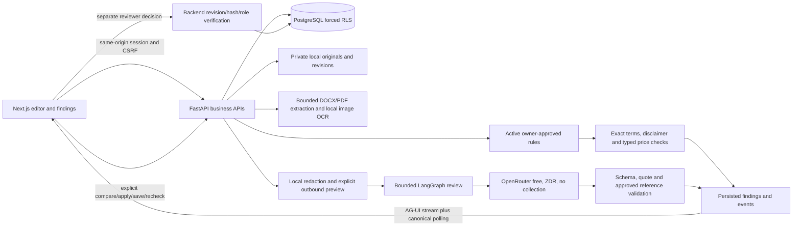

# Brand Content Review architecture — implemented prototype

## Latest simplified workflow

Rules → New review → Tracking are the primary tabs. Rules combines PDF/DOCX and separate/embedded images. Bounded AI intake proposes literal-backed rules; pending candidates have no review authority until owner confirmation. Editable fields preserve evidence; overlapping replacements require explicit acknowledgement.

`knowledge_snapshots` copies confirmed rules, source references/hashes, defaults and instructions. Additions/replacements append snapshots inside one visible version. New version starts empty. Reviews/rewrites pin snapshot and saved task scope; approval checks current snapshot, revision, scope, membership and reviewer. Historical evidence cannot mutate.

Intake processes four chunks/run with resumable progress. Coverage distinguishes missing, partial, unsupported and checked sources across the collection. Task/company intent is redacted and never overrides approved facts. Contextual review sends 24 selected sources; omitted contextual guidance remains incomplete rather than passing.

Static image preview binds candidate/reference SHA hashes. Local dominant-palette observations cite literal source colours. Optional free vision requires image/schema capability and the same cost/privacy guards. Previewed pixels are unredacted; observations are advisory. Pure visual checks need no OCR transcript; printed text checks do. No image corrections, video, exact font identification or exhaustive accessibility certification.

Per-account tutorial creates an idempotent isolated fictional organisation with unconfirmed source proposals, sample content and no fabricated AI results/consent. Assistant and recurrence analytics remain future work. Latest free vision probe found no compatible endpoint.

## Request and data flow

The browser editor and its workers are served locally. Telemetry, proofing and automatic hyperlink navigation are disabled. No editor cloud service is needed. Image OCR uses the installed Windows engine locally; unavailable OCR requires manual transcription. PDF image regions and unsupported DOCX text parts remain incomplete coverage.

## Durable contracts

- A draft points to an immutable current revision. Saves require the expected current revision; restoration creates another revision. DOCX hashes cover the saved bytes; image hashes bind original bytes and verified transcript.
- A review pins draft revision and active guideline version. Approved rules and excerpts alone become factual authority. Deterministic findings and contextual AI findings retain their distinct status and origin.
- Run state/events are persisted. Disconnect recovery reads canonical state; reconnecting does not restart inference. Cancelled/interrupted jobs cannot become successful through a late result.
- Rewrite runs are separate from review runs. Protected values and newly introduced deterministic problems are checked locally, followed by a separate bounded model judgement. The user applies a safe option and must save/recheck.
- Approval requests bind a completed latest review and artifact. The creator, author and submitter cannot approve their own work. Edits, rule activation, reviewer revocation and rechecks supersede affected pending requests. Approval requires active membership, assigned reviewer, current rules/revision/hash and manual inspection acknowledgement where applicable.
- Browser buffers retain their base version when another session saves. Clean buffers adopt the new version; dirty buffers show a conflict and cannot submit or silently overwrite it. DOCX readiness is bound to the loaded source URL.

## Storage and authorisation

PostgreSQL uses a UTF-8 database, an owner role for migrations and a restricted runtime role with forced tenant RLS. Version/event/decision/comment/audit records have append-only protections. Application APIs check organisation membership, role and ownership before access. Local private files are addressed through authorised endpoints, never public static paths. Sessions are HttpOnly/SameSite cookies with hashed server tokens and expiry; passwords use Argon2.

The discovered WIN1252 database was retained. A non-destructive copy to `inkloom_utf8` verified all table counts; tests use separate `inkloom_test_utf8`. Migrations are tracked in `schema_migrations`.

## External processing boundary

The API reads the ignored root `.env`. Keys and local redaction mappings are never returned to the browser/provider. An owner must enable a versioned policy; the creator then previews and deliberately dispatches each review. Payload hashes detect a changed preview. Stable private placeholders minimise selected identifiers; confidential business facts can still remain in the wording.

Requests require a free catalogue model, zero prices, supported response formatting, ZDR, denied data collection and no route fallback. Quota is checked before dispatch; ten requests are reserved and each server process permits at most ten completion attempts. One bounded structured-output repair may consume an additional attempt. No remote tools or paid plugins are enabled. Capacity/policy/schema/evidence failures produce incomplete results and block approval.

These settings do not establish a company data-processing agreement or guarantee confidentiality. Real materials require the company's permission and suitable deployment/access/retention controls.

## Prototype boundaries

Jobs use in-process background work and a single provider lock; this is not a durable distributed worker fleet. Limits/rate controls are process-local. PDF parsing and local disk storage require further resource/isolation work before untrusted hosted deployment. Identity email ownership, password reset, retention deletion, encrypted object storage, backups and production monitoring remain future work. The current browser CSP is suitable for local development and still permits development inline/eval script behavior.

No auto-publication API exists. No inferred compliance score is shown. Source retrieval is bounded lexical selection, not a trained embedding index. Optional static vision is implemented but its latest live route is unavailable; assistant and recurrence analytics remain outside the delivered core.
